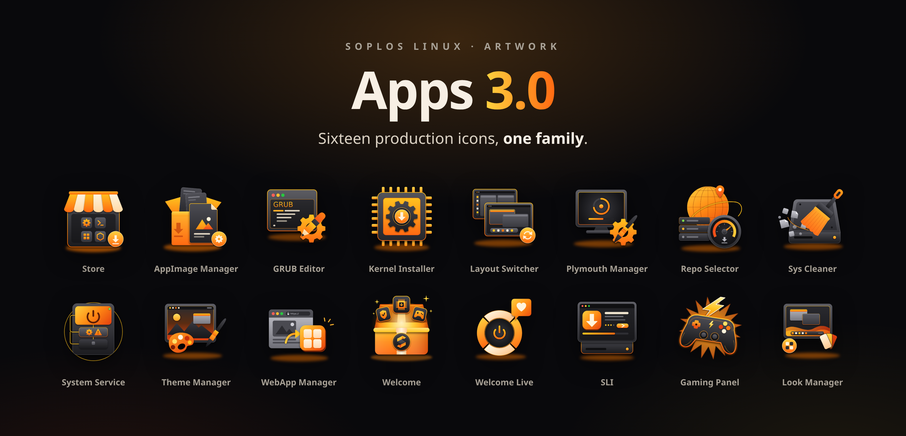
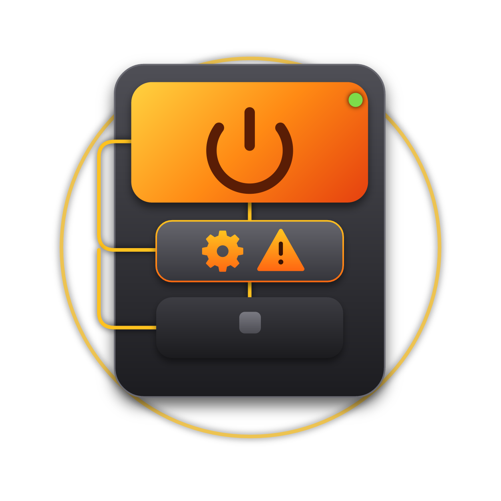

<p align="center">
  
</p>

<p align="center">
  <a href="https://github.com/SoplosLinux/soplos-artworks/blob/main/LICENSE"></a>
  
  
  
  
  <a href="https://github.com/SoplosLinux/soplos-artworks/commits/main"></a>
  <a href="https://github.com/SoplosLinux/soplos-artworks/stargazers"></a>
</p>

# Soplos Linux · Artwork

🇬🇧 **English** · 🇪🇸 [Español](README.es.md)

Official artwork of **Soplos Linux**: the sixteen production icons of the 3.0 applications, the animated presentation that goes with them, and the wallpapers of the distro.

The icons are meant to be used as they are in the system: they **have no backplate** (the dark rounded square of the old icons), they are transparent, and they share the same style, palette and volume.

## Icons

Each app has its own folder with four files:

| File | Purpose |
| --- | --- |
| `.svg` | Vector with no background. This is the production format. |
| `.png` | 1254 × 1254 px with transparency. |
| `.psd` | Layered file to edit in Photocraft or Photoshop. Groups with shadows or blur are rasterized. |
| `.vectorcraft` | Original VectorCraft project, to edit the drawing. |

### The sixteen apps

| | App | What it does | Folder |
| :---: | --- | --- | --- |
|  | **Store** | Installs, updates and removes APT, Flatpak, Snap and AppImage apps, and applies firmware updates with fwupd. | [`soplos-store`](soplos-store) |
|  | **AppImage Manager** | Integrates AppImages into the desktop and checks for their updates. | [`soplos-appimage-manager-3.0`](soplos-appimage-manager-3.0) |
|  | **GRUB Editor** | Edits the bootloader without touching any file by hand. | [`soplos-grub-editor-3.0`](soplos-grub-editor-3.0) |
|  | **Kernel Installer** | Downloads, patches and installs the Linux kernel. | [`soplos-kernel-installer-3.0`](soplos-kernel-installer-3.0) |
|  | **Layout Switcher** | Four GNOME layouts (Soplos, Dock, Tiling and GNOME) in one click. | [`soplos-layout-switcher-3.0`](soplos-layout-switcher-3.0) |
|  | **Plymouth Manager** | Manages the boot splash screen, with a real preview. | [`soplos-plymouth-manager-3.0`](soplos-plymouth-manager-3.0) |
|  | **Repo Selector** | APT repositories, mirrors and GPG keys under control. | [`soplos-repo-selector-3.0`](soplos-repo-selector-3.0) |
|  | **Sys Cleaner** | Frees up space by deleting only what you confirm. | [`soplos-sys-cleaner-3.0`](soplos-sys-cleaner-3.0) |
|  | **System Service** | systemd services and timers without the command line. | [`soplos-system-service-3.0`](soplos-system-service-3.0) |
|  | **Theme Manager** | Theme manager for Tyron (Xfce). | [`soplos-theme-manager-3.0`](soplos-theme-manager-3.0) |
|  | **WebApp Manager** | Turns any website into an app with its own isolated profile. | [`soplos-webapp-manager-3.0`](soplos-webapp-manager-3.0) |
|  | **Welcome** | Welcome app: updates, drivers, security and gaming. | [`soplos-welcome-3.0`](soplos-welcome-3.0) |
|  | **Welcome Live** | Welcome app for the Live ISO, and system rescue. | [`soplos-welcome-live-3.0`](soplos-welcome-live-3.0) |
|  | **SLI** | Soplos Linux Installer, the in-house installer that will replace Calamares. | [`soplos-linux-installer`](soplos-linux-installer) |
|  | **Gaming Panel** | Overlay panel (Ctrl+Shift+G) that controls GameMode live. | [`soplos-gaming-panel`](soplos-gaming-panel) |
|  | **Look Manager** | Themes and layout for Tyson (Plasma). | [`soplos-look-manager`](soplos-look-manager) |

The Soplos desktops are **Boro** (GNOME), **Tyron** (Xfce) and **Tyson** (Plasma). SLI and Look Manager are new apps, and the presentation marks them as "Coming soon".

## Presentation

The [`presentación/`](presentaci%C3%B3n) folder holds an animated HTML presentation that walks through the sixteen apps with their icons. Nothing to install: just open it in a browser.

> **For now the presentation is available in Spanish only.** It is planned to be integrated into the official Soplos website and translated into the languages of the distros: English, German, French, Italian, Portuguese, Romanian and Russian.

| File | Contents |
| --- | --- |
| [`index.html`](presentaci%C3%B3n/index.html) | Horizontal version (16:9). Navigate with `←` `→`, `Space` to pause, `G` for the index and `F` for fullscreen. |
| [`vertical.html`](presentaci%C3%B3n/vertical.html) | Vertical version (9:16), made for recording video for social media. Press `R` for recording mode. |
| [`textos.js`](presentaci%C3%B3n/textos.js) | Texts of the vertical version, split by language (only `es` today). |
| [`imagenes/`](presentaci%C3%B3n/imagenes) | The sixteen icons as PNG, shared by both versions. |

`vertical.html` already reads its texts from `textos.js` and accepts `?lang=xx`, falling back to Spanish. `index.html` still keeps its texts inside the file itself.

## Wallpapers

The [`wallpapers/`](wallpapers) folder holds the 29 wallpapers shipped with Soplos Linux, numbered `001.jpg` to `029.jpg`. All of them are JPG at 3840 × 2160 px (4K, 16:9). They are copies of the ones installed in `/usr/share/backgrounds/soplos`.

## Structure

```
soplos-artwork/
├── splash.png               header image of this README
├── soplos-<app>/            one folder per app: .svg, .png, .psd and .vectorcraft
├── wallpapers/              the 29 Soplos wallpapers (001.jpg … 029.jpg)
├── presentación/            HTML presentation (horizontal and vertical)
├── README.md
├── README.es.md             Spanish version of this README
├── CHANGELOG.md
└── LICENSE                  GNU GPL v3.0
```

App names (Store, GRUB Editor, Kernel Installer…) are brand names and are not translated.

## How they were made

1. The icon is drawn in **VectorCraft** and exported as an SVG with no background.
2. That SVG is opened in **Photocraft**, which produces the layered PSD and the PNG.

## Changelog

See the [CHANGELOG](CHANGELOG.md).

## License

This repository is licensed under the **GNU General Public License v3.0**, the same license as the rest of the Soplos Linux projects. See the [LICENSE](LICENSE) file.
